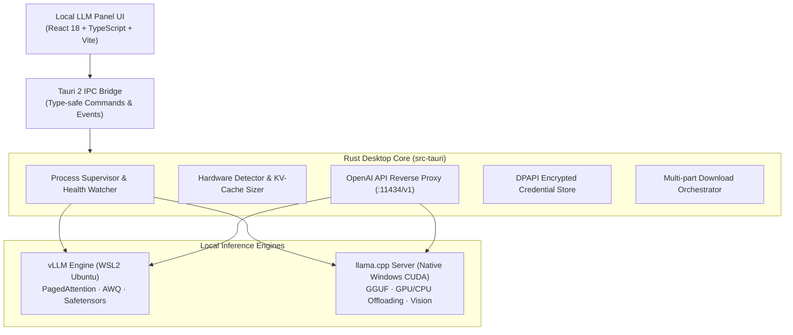

# Local LLM Panel

[](https://github.com/SeanDolan0/LocalLLmPanel/actions/workflows/ci.yml)
[](https://github.com/SeanDolan0/LocalLLmPanel/actions/workflows/codeql.yml)
[](https://github.com/SeanDolan0/LocalLLmPanel/actions/workflows/security-audit.yml)
[](https://github.com/SeanDolan0/LocalLLmPanel/releases)
[](LICENSE)
[](https://www.microsoft.com/windows)
[](https://v2.tauri.app)

A native Windows desktop control panel for discovering, sizing, downloading, orchestrating, and monitoring local large language models. It brings **high-throughput vLLM in WSL2** and **native llama.cpp on Windows** together behind one unified interface and an OpenAI-compatible API gateway.

> **Local inference, hardware-aware memory planning, and unified server orchestration.** Estimates are estimates — measured performance wins.

---

## Architecture Overview



Read more about the design principles and comparative analysis in [ABOUT.md](ABOUT.md).

---

## What It Does

| Area | Capabilities |
|---|---|
| 🔍 **Model Discovery** | Search Hugging Face and GGUF repositories, inspect parameter counts, quantization formats, and context lengths. |
| 📐 **Hardware Fit Planning** | Real-time memory accounting calculating weights, KV-cache footprint across context lengths, and GPU/RAM offload boundaries. |
| 🚀 **Dual Inference Engines** | Run high-throughput **vLLM** via WSL2 or lightweight **llama.cpp** native Windows processes side-by-side. |
| 🌐 **Unified OpenAI Gateway** | Route standard OpenAI `/v1/chat/completions`, `/v1/completions`, and `/v1/embeddings` requests to active servers with API key protection. |
| 📥 **Download Manager** | Resilient background downloads with multi-connection chunks, pause/resume, ETA tracking, and shard verification. |
| 📊 **Live Telemetry & Benchmarks** | Monitor real-time GPU VRAM, compute usage, process logs, token generation rates, and conduct repeatable benchmarks. |
| 🛡️ **Zero Telemetry & Local Security** | 100% localhost-bound by default. Tokens encrypted via Windows DPAPI. Zero remote analytics or telemetry. |

---

## Hardware & Sizing Reference

Local LLM Panel automatically reads your GPU's physical VRAM and calculates achievable context sizes. Below is a general guide for NVIDIA RTX workstations:

| GPU Tier | Typical VRAM | Recommended Models & Formats | Context Capacity |
|---|---|---|---|
| **Entry** | 8 GB | Llama 3.2 3B (Q8 / FP16), Qwen 2.5 7B (Q4_K_M), Mistral 7B (Q4_K_M) | 4K – 8K tokens |
| **Mid-Range** | 12 GB | Qwen 2.5 7B (Q8 / AWQ), Llama 3.1 8B (Q8 / FP16), Gemma 2 9B (Q5_K_M) | 8K – 32K tokens |
| **Enthusiast** | 16 GB | Qwen 2.5 14B (Q4_K_M / AWQ), DeepSeek-R1-Distill-Qwen-14B (Q4_K_M), Mixtral 8x7B (Q3_K_M) | 8K – 64K tokens |
| **High-End** | 24 GB | Qwen 2.5 32B (Q4_K_M / AWQ), Llama 3.1 70B (IQ2_XS offload), DeepSeek-R1-Distill-32B | 16K – 128K tokens |

---

## Quick Start

### Prerequisites

- **OS:** Windows 11 x64 (Build 22000+) with WebView2 installed.
- **Hardware:** NVIDIA GPU with current Game Ready or Studio Drivers (CUDA 12.x compatible).
- **For vLLM:** WSL2 with Ubuntu 22.04 / 24.04 and NVIDIA CUDA WSL drivers.
- **For llama.cpp:** No WSL required; panel can download compatible Windows CUDA `llama-server.exe` binaries directly.
- **For Development:** Node.js 22+, Rust 1.80+ (MSVC target), Visual Studio 2022 C++ Build Tools, and LLVM/LLD.

### Running from Source

```powershell
# Clone the repository
git clone https://github.com/SeanDolan0/LocalLLmPanel.git
cd LocalLLmPanel

# Install frontend dependencies
npm ci

# Launch desktop app in development mode
npm run tauri dev
```

### Building Standalone Executable & Installer

```powershell
# Build fast standalone Windows executable (dist-release/LocalLLMPanel-v*.exe)
npm run build:fast

# Build complete NSIS installer setup executable
npm run build:setup
```

---

## OpenAI-Compatible Gateway

The panel includes a high-performance reverse proxy that presents a standard OpenAI-compatible API surface for external applications (Continue, Cursor, Open WebUI, LangChain, LlamaIndex, etc.).

Enable the gateway under **Settings → Advanced Mode → Network**. Default endpoint:
```text
http://127.0.0.1:11434/v1
```

### Example: Streaming Chat Completion (cURL)

```bash
curl http://127.0.0.1:11434/v1/chat/completions \
  -H "Authorization: Bearer $LOCAL_LLM_KEY" \
  -H "Content-Type: application/json" \
  -d '{
    "model": "Qwen/Qwen2.5-7B-Instruct",
    "messages": [
      {"role": "system", "content": "You are a helpful programming assistant."},
      {"role": "user", "content": "Write a Rust function to calculate Fibonacci numbers."}
    ],
    "stream": true
  }'
```

### Example: Python (`openai` SDK)

```python
from openai import OpenAI

client = OpenAI(
    base_url="http://127.0.0.1:11434/v1",
    api_key="your-configured-key"
)

response = client.chat.completions.create(
    model="Qwen/Qwen2.5-7B-Instruct",
    messages=[{"role": "user", "content": "Explain how PagedAttention works in vLLM."}],
    stream=True
)

for chunk in response:
    if chunk.choices[0].delta.content:
        print(chunk.choices[0].delta.content, end="", flush=True)
```

---

## Development & Test Commands

| Target | Command | Purpose |
|---|---|---|
| **Development App** | `npm run tauri dev` | Starts Vite hot-reload frontend with debug Rust binary |
| **Preflight Check** | `npm run check` | Validates TypeScript, manifests, and Rust workspace |
| **Frontend Smoke Tests** | `npm run test:contract` | Verifies Tauri command contracts, routes, and security |
| **Frontend Build** | `npm run build` | Compiles TypeScript and runs Vite production bundling |
| **Rust Code Formatting** | `cd src-tauri; cargo fmt --all -- --check` | Validates formatting against Rust style guide |
| **Rust Linter** | `cd src-tauri; cargo clippy --workspace --all-targets --locked` | Runs Clippy static analysis across all crates |
| **Rust Unit Tests** | `cd src-tauri; cargo test --workspace --locked` | Executes comprehensive workspace test suite (500+ tests) |
| **Standalone Executable** | `npm run build:fast` | High-speed release build using LLVM lld-link |
| **NSIS Setup Installer** | `npm run build:setup` | Generates Windows installer and SHA-256 checksums |
| **Release Validation** | `npm run release:check` | Confirms synchronized versioning across all manifests |

---

## Repository Structure

```text
LocalLLmPanel/
├── .github/
│   ├── ISSUE_TEMPLATE/        # Structured GitHub Issue Forms (bug, feature, model)
│   ├── workflows/             # GitHub Actions CI, CodeQL, release, and audit pipelines
│   ├── dependabot.yml         # Automated weekly dependency updates
│   └── pull_request_template.md
├── docs/
│   ├── USER_GUIDE.md          # Comprehensive user manual and troubleshooting
│   ├── ARCHITECTURE.md        # Technical architectural design document
│   ├── ROADMAP.md             # Project roadmap and milestones
│   └── DEPLOYMENT.md          # Packaging and release procedure
├── scripts/
│   ├── build.mjs              # Multi-target build runner with LLD optimization
│   ├── frontend-smoke.mjs     # Automated contract and security test suite
│   └── validate-release.mjs   # Release manifest and artifact validator
├── src/                       # React 18 frontend (Vite + TypeScript + Tailwind)
│   ├── components/            # Reusable UI components and modal dialogs
│   ├── pages/                 # Dashboard, Search, Library, Servers, Settings
│   └── api.ts                 # Type-safe Tauri IPC wrapper
├── src-tauri/                 # Rust application backend (Tauri 2)
│   ├── crates/llmfit-core/    # Hardware detection, model fitting, and context sizing library
│   └── src/                   # Server supervisor, WSL bridge, gateway, DPAPI vault
├── ABOUT.md                   # Project background and comparative analysis
├── CONTRIBUTING.md            # Contributor guidelines and workflow
├── SECURITY.md                # Security reporting and cryptographic guarantees
├── LICENSE                    # MIT License
└── README.md                  # Project landing page
```

---

## Documentation Links

- 📖 **[User Guide](docs/USER_GUIDE.md)** — Step-by-step first run, FlashInfer setup, GGUF offloading, and troubleshooting.
- 🏛️ **[About & Principles](ABOUT.md)** — Design philosophy, architectural goals, and ecosystem comparisons.
- 📐 **[Architecture](docs/ARCHITECTURE.md)** — Deep dive into modules, state machines, and Tauri IPC commands.
- 🤝 **[Contributing](CONTRIBUTING.md)** — Pull request expectations, style rules, and developer guidelines.
- 🔒 **[Security Policy](SECURITY.md)** — Vulnerability reporting, encryption details, and localhost assurances.
- 📜 **[License](LICENSE)** — MIT License.
